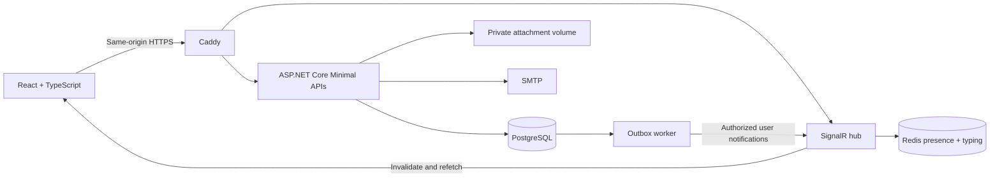

# Architecture

## Boundaries

Hearth is a modular monolith for a small community, deployed as **one application replica**. Feature modules live in the API project and own their routes and use cases. The domain project has no external dependencies. Infrastructure provides EF Core/Identity, private file storage, Redis state, and SMTP delivery. The API references both layers through its Infrastructure project reference.

## Data model

| Area | Records and constraints |
| --- | --- |
| Identity | Standard ASP.NET Identity tables; UUID users; unique normalized username and email; display name and DM privacy |
| Communities | Servers, composite-key memberships, server roles, assignments, channels, role/member channel grants, bans |
| Invitations | Hashed random tokens, expiration, redemption count/limit, revocation; serializable redemption transaction |
| Conversations | Either server channel or canonical pair of distinct DM participants, enforced by a check constraint; unique DM pair |
| Messages | Increasing bigint ID, conversation/ID history index, unique author/client ID for retry deduplication, reply pointer, edit timestamp, deletion flag |
| Interaction | Unique message/user/emoji reaction, monotonic conversation/user read position, canonical friendship pairs and directional blocks |
| Files | Private storage key, display filename, content type, uploader, conversation and optional message binding |
| Operations | Transactional outbox and server moderation audit metadata |

Schema changes use EF Core migrations. The initial SQL migration and frozen model snapshot are included. A test that requires no database connection detects differences between the snapshot and runtime model. Migrations are applied explicitly with `--migrate`; application startup never uses `EnsureCreated`.

## Message lifecycle

1. The browser sends a POST containing a client-generated UUID, content, optional reply ID, and pending attachment IDs.
2. The API authenticates the cookie, validates CSRF, checks current read/send access, and verifies attachment ownership and conversation binding.
3. A PostgreSQL transaction persists the message, attaches files, and adds an outbox row. Duplicate client IDs return the original message; using the ID for a different conversation is rejected.
4. The background dispatcher reevaluates current recipients and sends a small invalidation through authenticated SignalR user routing. It never emits message bodies into cached group memberships.
5. React Query refetches affected history and conversation counts. Retryable outbox deliveries may repeat; cache invalidation is idempotent. A reconnect refreshes all active queries, including loaded history pages.

The outbox provides at-least-once notification attempts to currently connected sessions, not offline event storage or guaranteed per-device delivery. PostgreSQL remains authoritative. REST refresh recovers state if the connection was absent or a send succeeded immediately before a process failure.

## Concurrency and scale

A single-replica semaphore spans authorized endpoint handlers and live recipient evaluation. This orders kicks/permission changes with access checks and notifications. Authentication, rate limiting, CSRF, and request-body parsing precede the gate; file/response streaming follows it. Waiters receive 503 after two seconds instead of queuing indefinitely. Database transactions within the process remain serialized, which is appropriate for the intended ten-user group.

Database uniqueness/check constraints and the serializable invitation transaction protect durable invariants. To scale out: replace the process gate with transactionally coordinated permission/version checks; adopt shared object storage; add a SignalR backplane/service and session revocation coordination; move rate limits to a distributed store or gateway; coordinate outbox claims between workers. Redis currently handles ephemeral state only, not durable messages or authorization caching.

Presence records are per connection with expiry, so closing one browser tab cannot clear another tab's presence. Heartbeats refresh TTLs. Typing is throttled with short-lived Redis keys; clients expire indicators independently.

## Frontend

React Router owns navigation, React Query owns server state, and local component state owns drafts/dialogs. There is no persisted authentication token. URL parameters select server/conversation. The chat timeline renders restricted Markdown and explicit attachments; external Markdown images are omitted to avoid third-party tracking.

The current draft survives an unsuccessful send and reuses its client ID on retry. Drafts are local to the open conversation and are not retained across reloads or channel changes. Uploads abandoned by navigation are reclaimed after 24 hours.

## API overview

- `/api/v1/auth`: verification, sign-in, recovery, profile, CSRF, logout, and 2FA.
- `/api/v1/servers`: server lifecycle, members, bans, audit, roles, channels, and invitations.
- `/api/v1/invites/redeem`: join through an invitation.
- `/api/v1/relationships`: user search, friends, requests, and blocks.
- `/api/v1/dms`: list/open a one-to-one conversation.
- `/api/v1/conversations/{id}`: messages, reactions, read position, and pending uploads.
- `/api/v1/attachments/{id}`: authenticated download/removal of pending upload.
- `/hubs/chat`: authenticated updates, heartbeat, and typing. No message mutation methods.
- `/health/live`, `/health/ready`: process and dependency checks.

Invalid requests use Problem Details, with 401 for missing authentication, 403 for known disallowed operations, and 404 for inaccessible content. Validation and database conflicts produce 400/409. Development OpenAPI is exposed at `/openapi/v1.json`.
